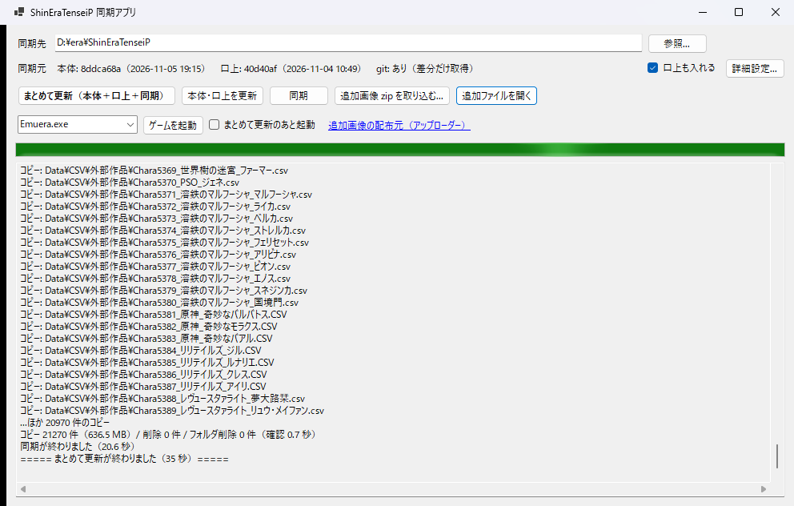
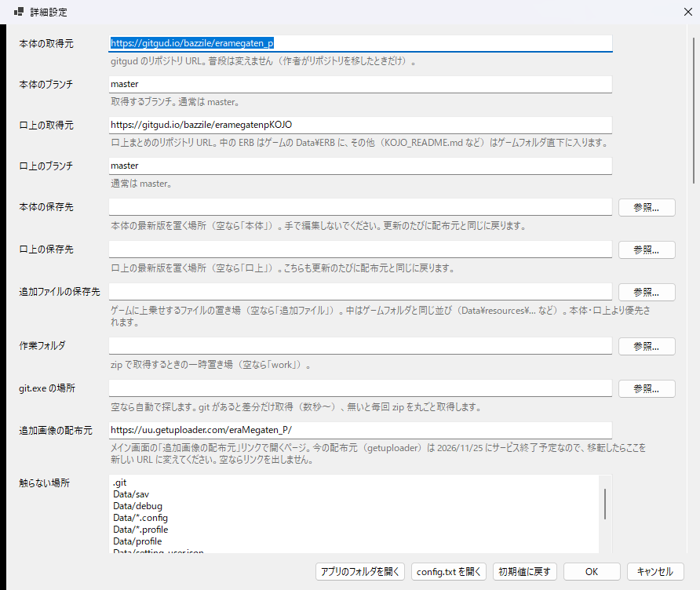

# ShinEraTenseiP 同期アプリ

era バリアント「[ShinEraTenseiP](https://gitgud.io/bazzile/eramegaten_p)」の
**本体・口上の取得 → ゲームフォルダへの同期** をボタン一つで行う Windows 用 GUI アプリです。



> [!NOTE]
> 非公式ツールです。ShinEraTenseiP の作者・開発者とは関係ありません。
> 不具合や要望はこのリポジトリの Issues へお願いします（本体側には問い合わせないでください）。

## できること

- **本体・口上の取得**：gitgud の [本体](https://gitgud.io/bazzile/eramegaten_p) と [口上まとめ](https://gitgud.io/bazzile/eramegatenpKOJO) から最新版を取得します。
  Git for Windows が入っていれば前回からの差分だけを取得します（数秒〜数十秒）。無ければ毎回 zip を丸ごと取得します。
- **同期**：ゲームフォルダを「本体 → 口上 → 追加ファイル」を重ねた中身にそろえます。
  セーブ（`Data\sav`）や設定ファイル、ゲームフォルダ直下に置いた exe などはそのまま残します。
- **追加画像の取り込み**：別配布の追加画像 zip を取り込みます（ウィンドウへのドロップも可）。zip の外側のフォルダは自動で外れます。
- **まとめて更新**：取得と同期を一度に行い、終わったらそのままゲームを起動することもできます。
- 起動中のゲームの検出、削除するファイルの事前確認、保存先の重なりチェックなどの安全確認があります。

## 動作環境

- Windows 10 / 11（x64）
- [.NET 8 デスクトップ ランタイム](https://dotnet.microsoft.com/ja-jp/download/dotnet/8.0)（「.NET デスクトップ ランタイム 8.x」の x64 版）
- [Git for Windows](https://gitforwindows.org/)（推奨。無くても動きますが、毎回 zip を丸ごと取得するので遅くなります）

## 使い方

1. [Releases](../../releases/latest) から zip をダウンロードし、好きなフォルダに展開します（例：`D:\era\ShinEraTenseiP同期アプリ\`）。
2. `ShinEraTenseiP同期アプリ.exe` を起動します。
3. 「同期先」にゲームの `ShinEraTenseiP` フォルダを指定します。
   アプリのフォルダの隣に `ShinEraTenseiP` フォルダがあれば自動で入ります。新規インストールなら空のフォルダでもかまいません。
4. 「まとめて更新（本体＋口上＋同期）」を押します。
5. 削除するファイルがあるときだけ確認が出ます。ログで内容を確かめてから OK を押してください。

初回の同期は全ファイルの中身を比べるので数分かかります。2 回目以降は数秒です。

> [!IMPORTANT]
> 同期先のフォルダは、本体・口上・追加ファイルの内容に**そろえられます**。
> ゲームフォルダの中に直接置いたファイルや、直接書き換えた ERB・CSV は、下記の「触らない場所」に入っているもの以外は同期で消えるか元に戻ります。
> 自分で足したい画像や改造ファイルは、アプリの `追加ファイル` フォルダ（「追加ファイルを開く」ボタン）にゲームフォルダと同じ並びで置いてください。
> 例：`追加ファイル\Data\resources\50_依頼画像\…`
>
> 初めて使う前に、セーブデータ（`Data\sav`）のバックアップを取っておくと安心です。

## フォルダ構成

exe と同じフォルダに、必要になった時点で次のファイルとフォルダが作られます（exe 一つだけ置いても動きます）。保存先は「詳細設定」で変更できます。

| パス | 内容 |
|---|---|
| `config.txt` | 設定（すべての設定がこのファイル 1 つに入ります） |
| `本体\` | 本体の最新版（gitgud: `bazzile/eramegaten_p`）。更新のたびに配布元と同じに戻るので、手で編集しないでください |
| `口上\` | 口上の最新版（gitgud: `bazzile/eramegatenpKOJO`）。中の `ERB\` はゲームの `Data\ERB\` に、その他はゲームフォルダ直下に入ります |
| `追加ファイル\` | ゲームに上乗せするファイル（追加画像・自作ファイルなど）。本体・口上より優先されます |
| `work\` | zip で取得するときの一時置き場 |

### 同期で触らない場所（既定）

`.git`、`Data/sav`、`Data/debug`、`Data/*.config`、`Data/*.profile`、`Data/profile`、`Data/setting_user.json`、
`Data/resources/画像_自家製`、`*.log`、`*.dat`、`console_history.json`

このほか、ゲームフォルダ直下のファイル（`EmueraEX.exe`、`emuera.config` など）は書かなくても消しません。
「詳細設定」で追加・削除できます。

## 追加画像について

追加画像（ニカイア動画のイベント画像など）は本体とは別に、アップローダーで配布されています（DL パスワードが必要）。
ダウンロードした zip を「追加画像 zip を取り込む」で取り込むと、次の同期でゲームに入ります。

> [!WARNING]
> 現在の配布元（uploader.jp / getuploader）は **2026/11/25 にサービスを終了する予定**です。
> 配布元が移転したら、「詳細設定」→「追加画像の配布元」を新しい URL に変えてください（メイン画面のリンク先が変わります。空にするとリンクを出しません）。
> zip の取り込み機能は配布元に関係なく使えます。



## ビルド

.NET 8 SDK が必要です。

```powershell
dotnet publish -c Release -o bin/publish
```

`bin/publish/ShinEraTenseiP同期アプリ.exe` が出力されます（単一ファイル。.NET 8 デスクトップ ランタイムが必要）。

## 注意事項

- 更新内容（コミットの題名）の表示に gitgud（GitLab）の API を未認証で使っています。取得できなくても更新自体には影響しません。
- git は同梱しておらず、インストール済みの `git.exe` を外部から呼び出すだけです。
- 本体・口上・画像の著作権は、それぞれの作者に帰属します。このアプリは取得と配置を自動化するだけで、ゲームのデータは同梱していません。
  本体・口上の利用条件は、各配布物の `LICENSE.md` / `README.md` に従ってください。

## ライセンス

[MIT License](LICENSE)

## 謝辞

- [ShinEraTenseiP](https://gitgud.io/bazzile/eramegaten_p) の作者 bazzile 氏、口上・画像作者の皆さま
- 公式の起動補助ツール GitCloner（VVII 氏作）。このアプリは別に作ったもので、そのコードは使っていません
